# 页间 · PAGE TALK

一个用于**深度阅读的 AI PDF 阅读器原型**。

你可以用钢笔、荧光笔、像素橡皮和套索直接在书页上圈画，在页边钉便签、选择或搜索书页中的真实文字；遇到读不懂的地方，框选一块内容，连同问题一起发送给指定的视觉模型。回答和追问都按 GitHub 风格的 Markdown + LaTeX 渲染，输入框也有 Writer/Preview 和格式工具条。手写公式可以交给本机 Ollama 识别成 LaTeX，墨迹与批注写入本机磁盘持久保存。界面保持安静的纸张感，同时把「阅读」「批注」「追问」放在同一个工作台里。

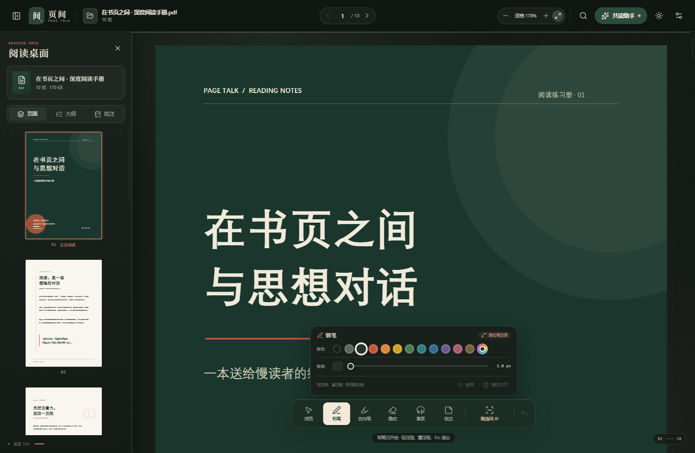

## 本轮改动（无终端 / 可调侧栏 / 独立笔宽 / 暗黑主题）

| # | 你的反馈 | 现在的实现 |
| --- | --- | --- |
| 1 | 打开成品会出现终端 | Tauri 主程序改为 Windows GUI subsystem；Node sidecar 继续使用 `CREATE_NO_WINDOW`。已验证 PE Optional Header 的 Subsystem = 2（GUI），启动时不再弹控制台。 |
| 2 | 侧边框改成可以拉动 | 侧栏右缘新增拖拽热区：220–440px，鼠标/触控板/键盘方向键都可调，双击恢复 274px；宽度写入 localStorage，窄屏覆盖式侧栏仍保持固定比例。 |
| 3 | 画笔粗细不要共用，最小 1px | 钢笔、荧光笔、橡皮分别维护自己的宽度；切换工具时滑杆回到该工具上次的值。滑杆最小值下调，渲染层把笔宽下限锁在 **1.0 px**，实测标签为 `1.0 px`。 |
| 4 | 加暗黑主题 | 顶栏与欢迎页都有主题按钮；首次跟随系统 `prefers-color-scheme`，之后记住选择。顶栏、侧栏、阅读背景、AI 面板、设置弹窗、Markdown 编辑器、画笔面板都做了深色适配，PDF 页面本身保持纸张白。 |

| 浅色 · 可调侧栏 | 深色主题 |
| --- | --- |
| 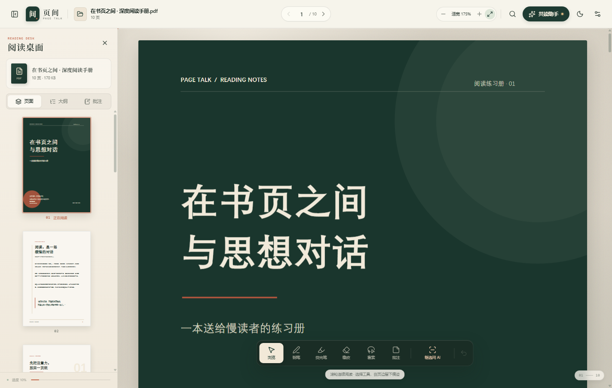 | 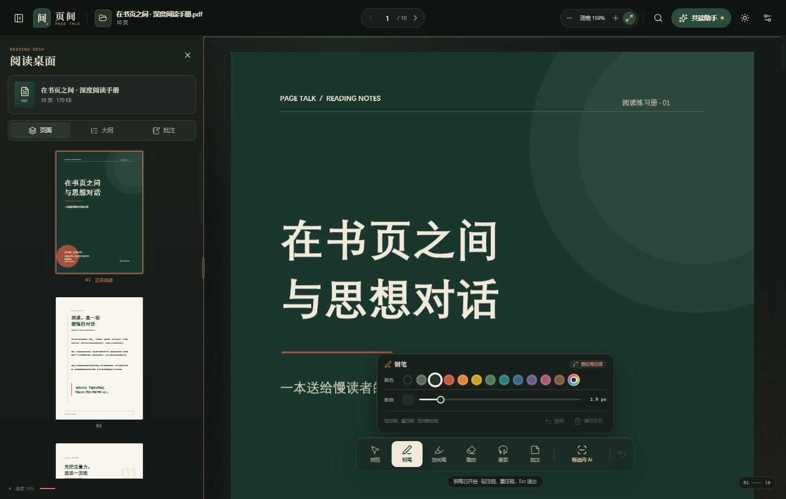 |

| 深色设置 | 深色欢迎页 |
| --- | --- |
| 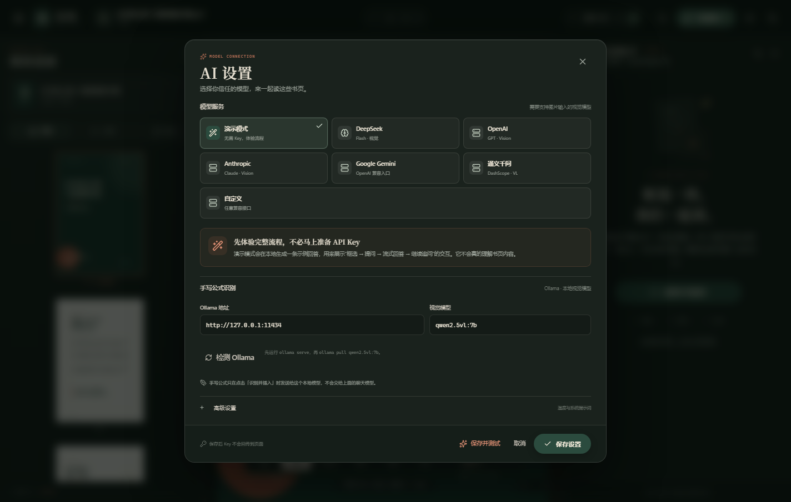 | 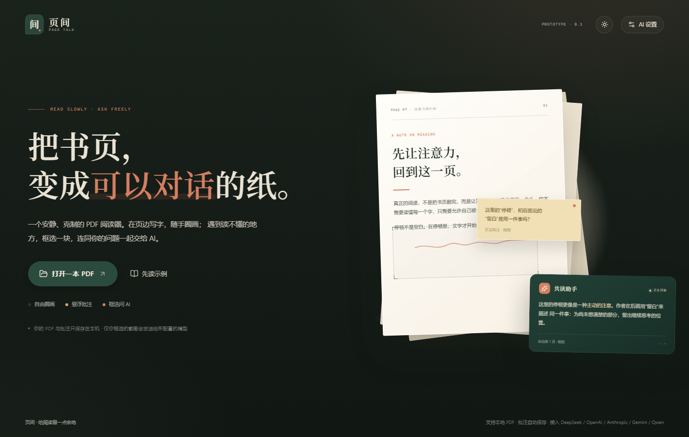 |

| 深色大纲 |
| --- |
| 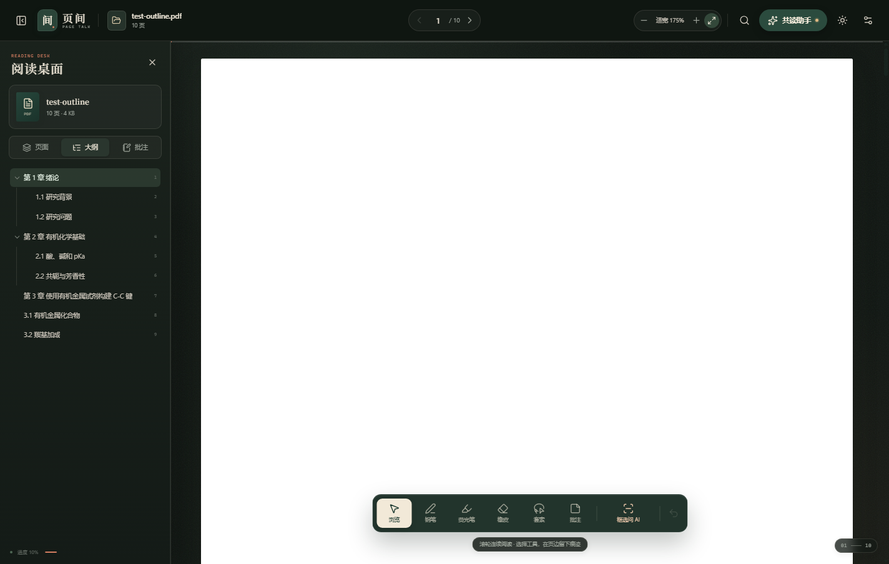 |

## 上一轮（Markdown 编辑器 / Ollama 手写 / Tauri）

| # | 你的反馈 | 现在的实现 |
| --- | --- | --- |
| 1 | 输入框要像 GitHub 一样能编辑 Markdown | 提问框和追问框共用 `MarkdownEditor`：编写 / 预览双标签，9 个格式按钮（加粗、斜体、标题、引用、列表、行内代码、链接、行内公式、独立公式），预览区直接渲染 GFM + KaTeX。 |
| 2 | 用 Ollama 识别手写 LaTeX 并启用 | 手写板不再是占位：真实画布、撤销/清空、PNG 提交、Ollama 识别、KaTeX 预览、插入原输入框。设置里新增 Ollama 地址/模型和「检测 Ollama」。 |
| 3 | 打包 | 新增 Tauri 2 桌面壳 + Node sidecar；Windows NSIS 安装包已生成，约 27.8 MB，内置 Node 运行时、前端、PDF.js 资源与本地代理。 |
| 4 | 继续保留上一轮能力 | 书写延迟、GFM/KaTeX 渲染、磁盘持久化、像素橡皮、套索、压感等全部保留。 |

| Markdown 编辑器 | Ollama 手写识别 |
| --- | --- |
| 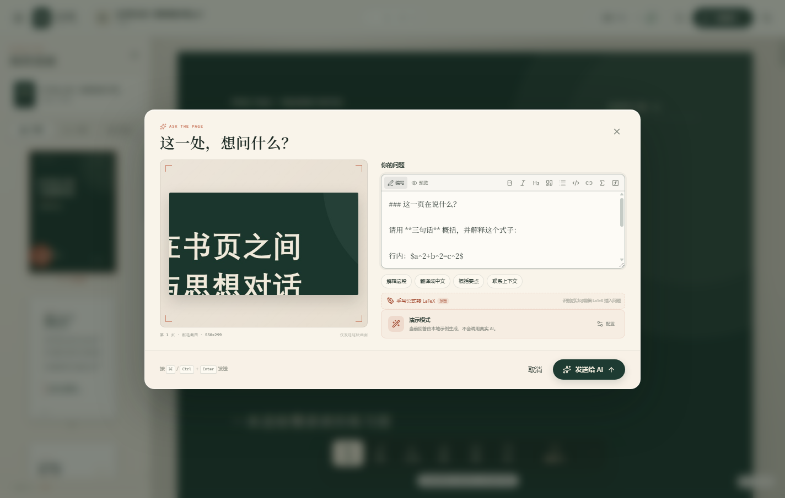 | 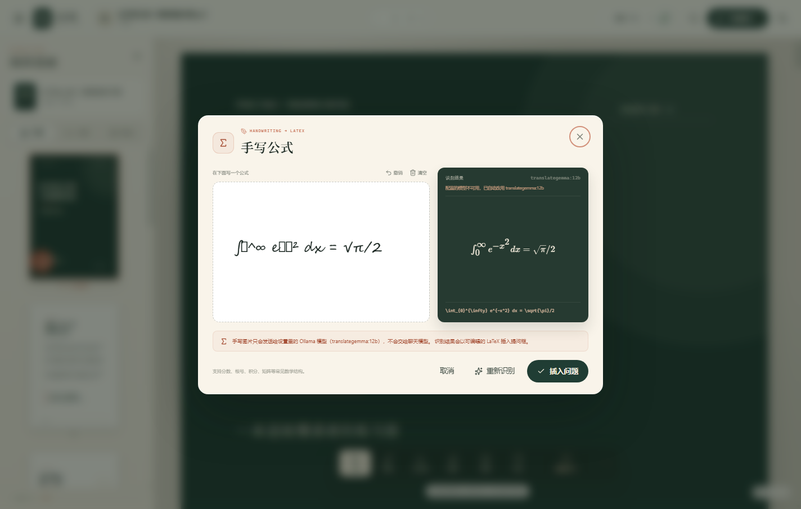 |

| Ollama 设置 | 桌面版 |
| --- | --- |
| 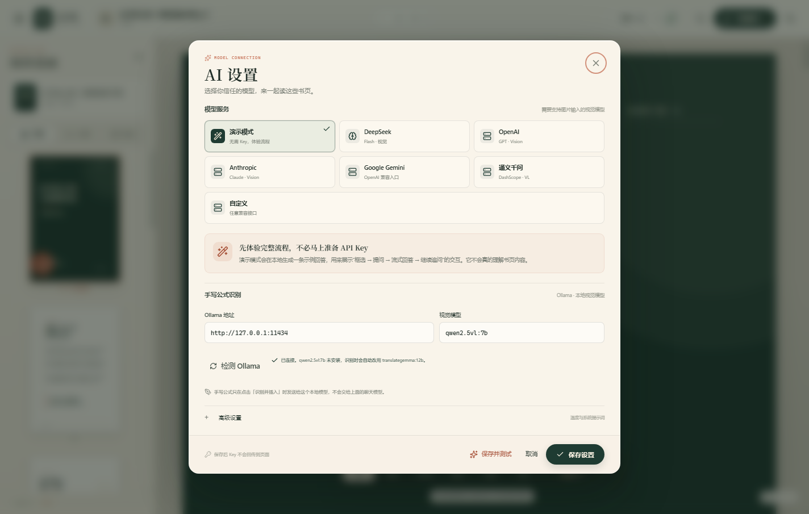 | 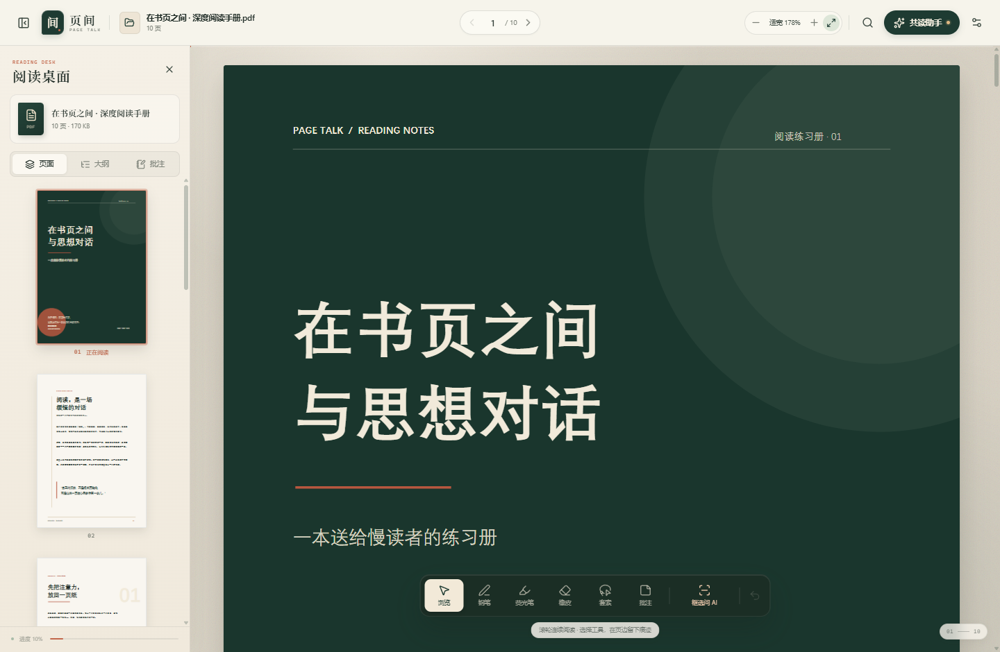 |

## 上一轮（书写手感 / 公式 / 持久化 / 手写入口）

| # | 你的反馈 | 现在的实现 |
| --- | --- | --- |
| 1 | 写字时有点小卡顿 | 已提交笔迹缓存进离屏 base canvas，指针移动时只做一次位图合成；视觉更新合并到 `requestAnimationFrame`，不再每个指针事件重放全部笔画。 |
| 2 | 发送文字时渲染 Markdown，尤其 LaTeX | 用户提问与 AI 回答共用 GitHub Flavored Markdown 渲染：表格、任务列表、引用、代码块、删除线等；公式用 `remark-math + rehype-katex` 渲染，支持 `$...$`、`$$...$$` 和 `\(...\)` / `\[...\]`。 |
| 3 | 墨迹、批注需要持久化 | 新增 `/api/annotations/:fingerprint` 读写接口，原子写入 `data/annotations/`；服务端与本地时间戳合并，浏览器缓存作为回退。侧栏显示正在写入/已保存/失败状态。 |
| 4 | 发送时加手写转 LaTeX，先预留位置 | 上一轮先加入入口与插入位置；本轮已接入 Ollama 识别、手写画板与结果预览。 |

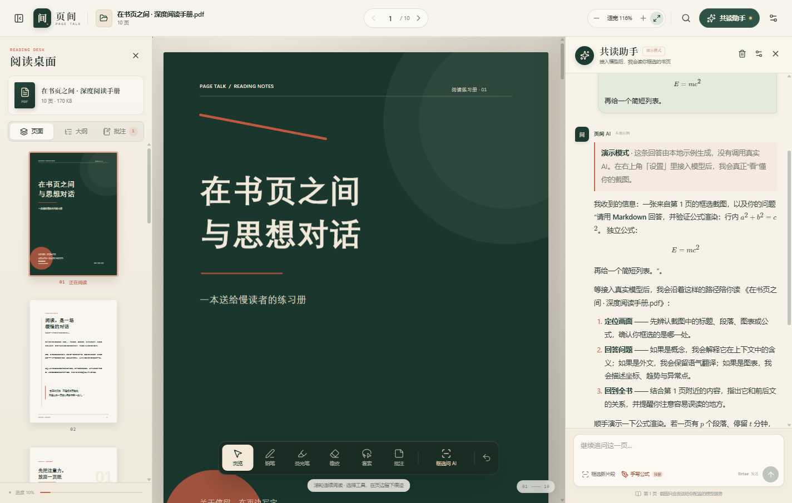

## 绘图工具升级（上一轮）

| # | 你的反馈 | 现在的实现 |
| --- | --- | --- |
| 1 | 添加选色功能 | 钢笔 12 色、荧光笔 7 色，另有自定义取色器；钢笔与荧光笔分别记住自己的颜色。颜色会随笔迹保存。 |
| 2 | 加入橡皮擦、荧光笔、套索和钢笔 | 四种工具齐全。橡皮是**像素级擦除**，只挖掉划过的区域，不删除整条笔画；套索可圈选、拖动、删除笔迹。 |
| 3 | 粗细改成无级调节 | 三档按钮换成连续滑杆，拖动时实时显示当前页上的实际笔宽（px），并给出笔尖预览。 |
| 4 | 钢笔压感再敏感一点 | 压感曲线更陡、起笔滞后更小：轻压迅速变细，重压可接近两倍笔宽；保留 coalesced events 高频采样与触摸防误触。 |
| 5 | 参考 Microsoft Whiteboard | 工具面板改为「当前工具 + 颜色 + 连续粗细 + 操作」的浮动面板；新增随指针移动的圆形笔尖光标与套索浮动操作条。 |
| 6 | 桌面选 Tauri，移动端暂缓 | 方向已确认。这轮先把绘图打磨好，Tauri 壳与 sidecar 封装放到下一阶段；移动端保留现有响应式与 API 地址预留。 |

## 当前可体验

- **本地 PDF 阅读**：打开/拖入 PDF；连续滚动、页码跳转、上一页/下一页、缩放、适合宽度、页面缩略图。
- **PDF 大纲**：层级化阅读目录，当前章节高亮，点击跳页；无大纲时给出明确空状态。
- **文字层**：页面上的真实文字可拖选、复制；绘制或框选时自动让出指针事件，不互相干扰。
- **全文搜索**：`Ctrl / ⌘ + F` 或顶部搜索按钮；跨页递增搜索、进度提示、无结果提示、命中高亮与自动定位。
- **自由绘图**：钢笔、荧光笔、像素橡皮、套索四种工具；钢笔与荧光笔分工具记忆颜色，支持自定义色；**钢笔、荧光笔、橡皮分别维护独立宽度**，连续滑杆最小可到 1.0 px，并实时显示当前页面上的实际 px；钢笔支持更灵敏的数位板压感。
- **可调侧栏**：拖拽侧栏右缘可在 220–440px 间调整，支持方向键、Home/End 与双击复位；宽度会记住，窄屏下仍使用覆盖式侧栏。
- **暗黑主题**：顶栏和欢迎页均可切换，首次跟随系统主题，之后持久化；阅读背景、侧栏、AI 面板、弹窗、Markdown 编辑器和画笔面板都有深色样式，PDF 书页仍保持白色纸张。
- **像素橡皮**：以 `destination-out` 擦除经过的像素，不删除整条笔画；擦完可继续在空白处落笔，也可撤销。
- **套索选择**：圈住笔迹后显示浮动操作条，可拖动整组笔迹、按 `Delete` 或点击删除、按 `Esc` 取消；移动/删除都可撤销。橡皮擦操作会随套索一起移动，已擦出的缺口不会留在原地。
- **绘制历史**：每次落笔、擦除、套索移动或删除都会进入本页撤销栈，最多保留 60 步；清空本页后也能撤销恢复。
- **悬浮文字批注**：页边便签，悬停预览、点击编辑、改色、删除；与墨迹一起按 PDF 指纹持久化到本机磁盘。
- **持久化**：笔迹、橡皮操作、套索位移和便签都会自动写入 `data/annotations/`，刷新浏览器或清空缓存后仍可恢复；浏览器 `localStorage` 作为离线回退，并按时间戳合并。
- **框选问 AI**：拖拽框选任意区域，截图会合成当前页手绘笔迹（不含便签卡片），再发送给模型。
- **Markdown / LaTeX**：用户提问和 AI 回答都按 GitHub 风格 Markdown 渲染；`$...$` 行内公式与 `$$...$$` 独立公式由 KaTeX 排版，也兼容 `\(...\)` / `\[...\]`。
- **Markdown 编辑器**：提问框和追问框都有「编写 / 预览」切换与加粗、斜体、标题、引用、列表、行内代码、链接、行内/独立公式按钮；预览直接渲染 GFM + KaTeX。
- **手写公式**：打开手写板用鼠标或数位笔写公式，点击「识别为 LaTeX」，经本地服务转发给 Ollama，先预览再插入原输入框；支持撤销、清空、重新识别。
- **Ollama 配置**：设置里可以填写 Ollama 地址与视觉模型，并「检测 Ollama」。配置模型未安装时，会自动沿用本机已安装的视觉模型，并在结果里标明。
- **桌面版**：Tauri 2 + Node sidecar，Windows NSIS 安装包；窗口通过本地端口加载同一套前端，启动不显示控制台，数据目录在系统的应用数据目录（不可写时自动回退）。
- **流式对话**：右侧 AI 面板逐字显示回答，可停止、继续追问、清空、放大截图；当屏幕较窄时自动改为覆盖式面板。
- **可配置 AI**：OpenAI 兼容接口（DeepSeek、OpenAI、Gemini、通义千问、自定义）与 Anthropic 原生接口。Key 只保存在本地服务端。
- **演示模式**：不填 Key 也能完整走通「框选 → 提问 → 流式回答 → 追问」流程。

| 文本选择 | 全文搜索 |
| --- | --- |
| 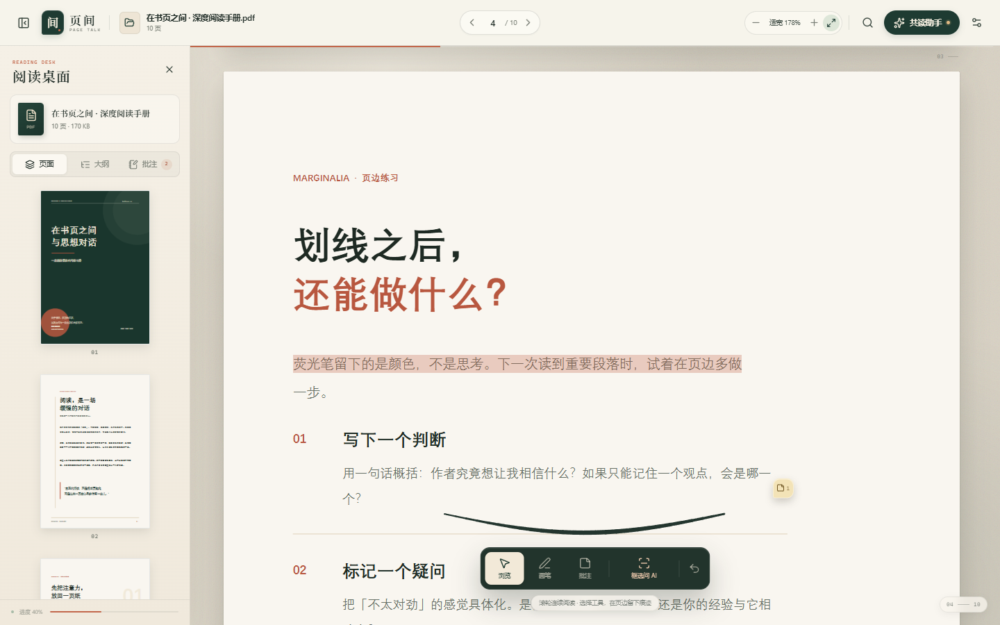 | 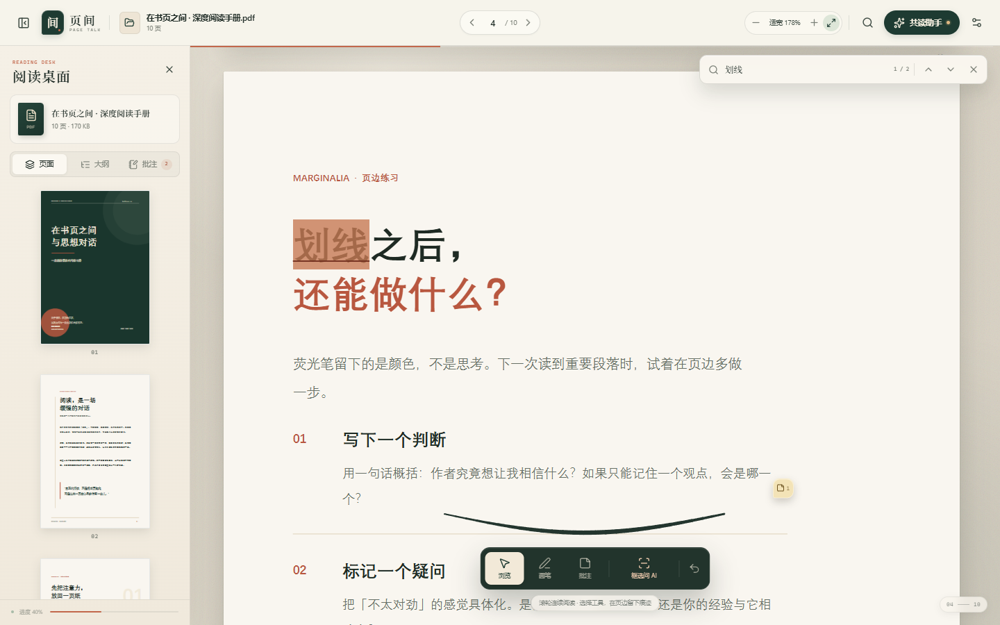 |

| 大纲导航 | DeepSeek 配置 |
| --- | --- |
| 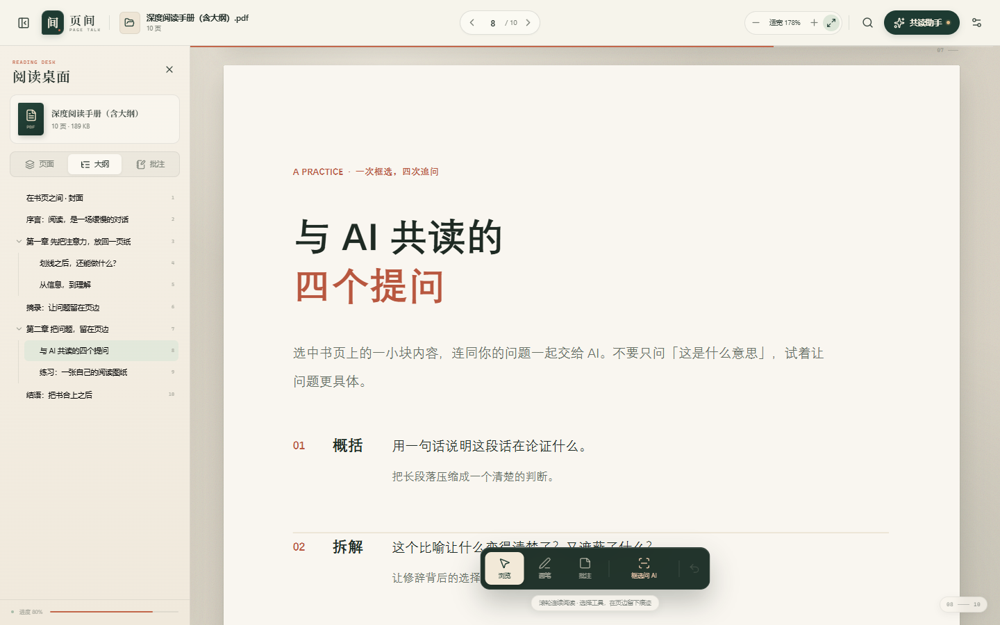 | 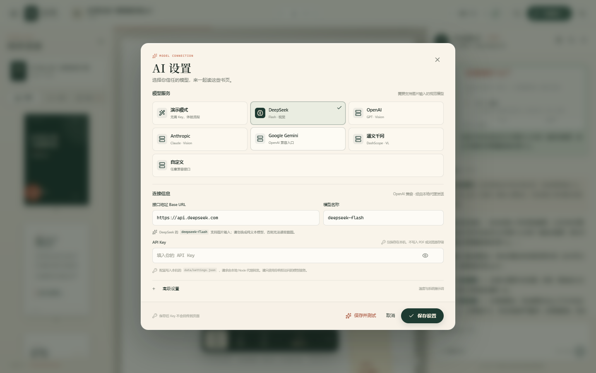 |

| 截图提问 | 共读面板 |
| --- | --- |
| 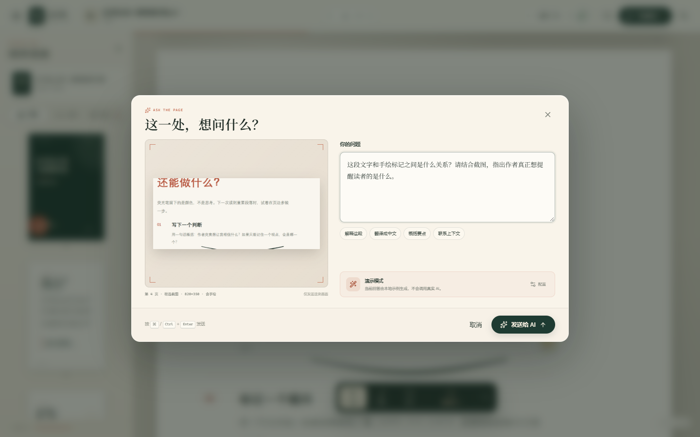 | 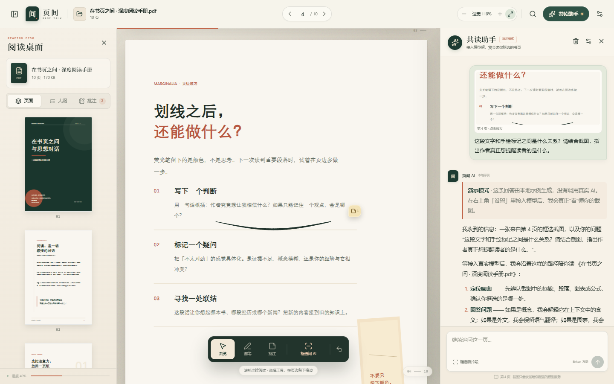 |

| 钢笔与荧光笔 | 套索选择 |
| --- | --- |
| 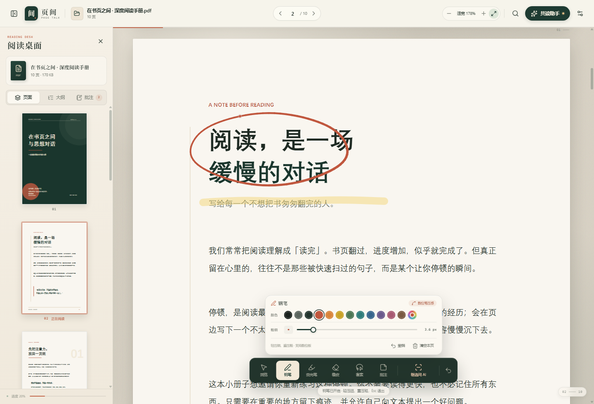 | 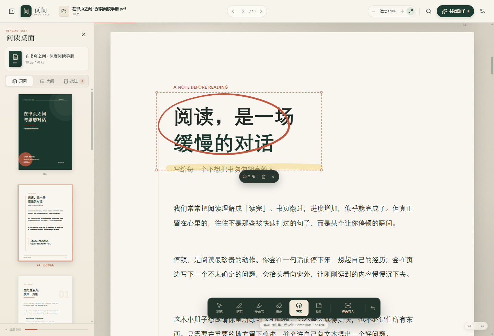 |

| 移动端绘图（移动端暂缓） |
| --- |
| 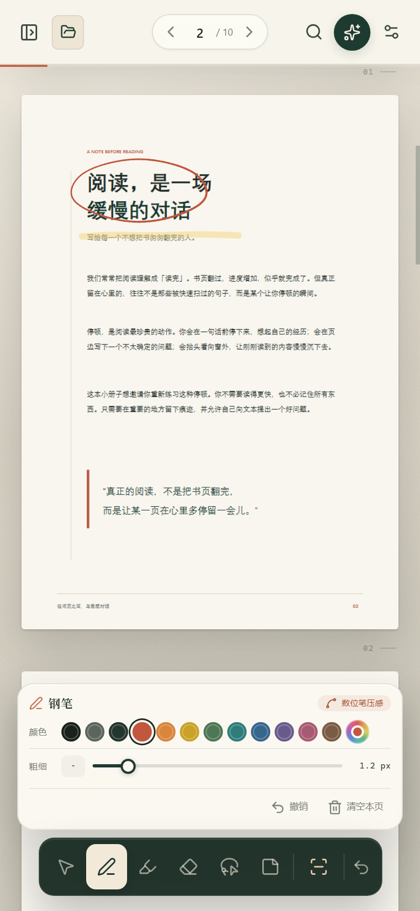 |

## 运行方式

环境：Node.js 20+（本机验证使用 Node 25）。

```bash
npm install
npm run build
npm start
```

打开 <http://127.0.0.1:8787>。

> 当前代码会话中服务已启动在 `http://127.0.0.1:8787`。关闭终端或服务后，按上面的命令重新启动即可。

开发模式（Vite 前端 5173 + Node API 8787，自动代理 `/api` 和 PDF.js 资源）：

```bash
npm run dev
```

### 桌面版（Tauri）

已生成 Windows x64 NSIS 安装包和免安装压缩包：

- [Page Talk_0.1.0_x64-setup.exe](<release/Page Talk_0.1.0_x64-setup.exe>) · 27.80 MiB  
  SHA-256：`33ac4cde635060a9bff240c268690f1b837e17faf241bad197ade1ecb197008a`
- [PageTalk-0.1.0-portable.zip](release/PageTalk-0.1.0-portable.zip) · 41 MiB（解压后运行 `page-talk.exe`）  
  SHA-256：`07e214ddfdd3134aca1de937ada02f0325e0b28375604c3cef52a901f2fffa03`

安装包内置 Node 运行时、前端、PDF.js 字体/CMap/WASM 与本地代理；主程序为 GUI subsystem，启动不会弹出终端窗口。应用数据（设置、批注、WebView2）优先写入系统的应用数据目录；若该目录不可写（例如受限沙箱），会退回到程序旁的 `PageTalkData/`，再退回系统临时目录。

重新打包：

```bash
npm run tauri:build
```

该命令会依次执行前端构建、`scripts/prepare-tauri.mjs`（复制 Web/PDF.js 资源、打包 Node 服务、复制 Node 运行时）和 `tauri build`。需要 Rust、WebView2 与 NSIS；首次构建会下载 Rust crate 和 NSIS。

> 安装包尚未做代码签名，Windows SmartScreen 可能提示“未知发布者”。当前构建在受限沙箱中验证时通过 `PAGE_TALK_DATA_DIR` 指定了可写数据目录；正常桌面会话会使用系统的 AppData 目录。

可用环境变量：

| 变量 | 说明 | 默认 |
| --- | --- | --- |
| `PORT` / `PDF_READER_PORT` | 本地服务端口 | `8787` |
| `AI_API_KEY` 或 `OPENAI_API_KEY` | 通过环境变量提供 Key（UI 中保存的配置优先） | 无 |
| `AI_BASE_URL` | 环境变量模式下的接口地址 | `https://api.openai.com/v1` |
| `AI_MODEL` | 环境变量模式下的模型名称 | `gpt-4o-mini` |
| `PDF_READER_DATA_DIR` | 配置与批注的本地数据目录 | 项目下的 `data/` / 桌面版 AppData |
| `OLLAMA_BASE_URL` | 手写公式识别使用的 Ollama 地址 | `http://127.0.0.1:11434` |
| `OLLAMA_MODEL` | 手写公式识别使用的视觉模型 | `qwen2.5vl:7b` |
| `ALLOWED_ORIGINS` | 允许跨域访问 API 的来源，逗号分隔；移动端远程连接时可使用 | 关闭 |
| `VITE_API_BASE_URL` | 前端构建时 API 根地址（也可在运行时注入 `window.__PAGE_TALK_API_BASE__`） | 同源 |

## 接入 AI

1. 点击右上角齿轮或欢迎页的「AI 设置」。
2. 选择服务，填入 **Base URL**、**模型名称**与 **API Key**。
3. 点击「保存并测试」。模型必须支持图片输入。
4. 回到阅读页，点击底部工具栏的「框选问 AI」，拖出区域并提问。

内置预设只是快捷填充，模型名称可随时编辑：

| 服务 | 协议 | 默认接口 | 示例模型 |
| --- | --- | --- | --- |
| **DeepSeek** | OpenAI 兼容 | `https://api.deepseek.com` | `deepseek-flash` |
| OpenAI | OpenAI 兼容 | `https://api.openai.com/v1` | `gpt-4.1-mini` |
| Anthropic | Anthropic 原生 | `https://api.anthropic.com` | `claude-sonnet-4-20250514` |
| Google Gemini | OpenAI 兼容 | `https://generativelanguage.googleapis.com/v1beta/openai` | `gemini-2.5-flash` |
| 通义千问 | OpenAI 兼容 | `https://dashscope.aliyuncs.com/compatible-mode/v1` | `qwen-vl-max` |
| 自定义 | 可选 | 自填 | 自填 |

DeepSeek 预设使用官方视觉模型 `deepseek-flash`，支持 Base64 图片输入；接口细节见 [DeepSeek Vision 文档](https://api-docs.deepseek.com/guides/vision/)。不同厂商的模型 ID 会变化，界面中可以直接修改。

API Key 会写入本机的 `data/settings.json`（已被 `.gitignore` 排除），仅由本地 Node 代理读取并转发；保存后浏览器只能看到「已配置」状态，无法再读回明文。请只使用你有权访问的模型服务。

### Ollama 手写公式

1. 启动 Ollama：`ollama serve`。
2. 拉取一个支持图片输入的模型，例如 `ollama pull qwen2.5vl:7b`。
3. 在「AI 设置 → 手写公式识别」填入地址和模型，点「检测 Ollama」。
4. 在提问框或追问框点「手写公式」，写完后点「识别为 LaTeX」，确认预览后插入。

默认地址是 `http://127.0.0.1:11434`。如果配置的模型没有安装，但本机已有其它带 `vision` 能力的模型，服务会自动改用第一个可用的视觉模型，并在手写结果面板里标明。手写只发送给 Ollama，不会进入上面的聊天模型上下文。

## 设计实现

- **文本层 / 搜索**：每一页的 canvas 上方叠加 PDF.js `TextLayer`，文字本身透明但可被浏览器原生选中。全文搜索会按批读取每页 `TextContent` 并缓存，使用 CSS Custom Highlight API 叠加全部命中与当前命中。当前命中会自动滚动到页内位置。
- **大纲**：通过 `getOutline()` 读取书签树，递归解析内部 destination 到物理页码；保留层级、粗体、斜体与颜色。大纲在 PDF 打开后异步加载，不阻塞首屏。
- **大文档性能**：页面尺寸以 16 路并发读取；正文只挂载当前视口前后约 1500px 范围内的页面，前后用占位高度维持正确滚动条；缩略图仍按可见性懒渲染。页码跳转直接按布局偏移计算，不依赖目标页已经挂载。
- **绘图引擎**：每一页维护一条有序笔迹操作流，笔迹带 `kind: pen | highlighter | eraser`、颜色、归一化宽度与采样点。绘制时按顺序重放：钢笔逐段变宽，荧光笔以 36% alpha 覆盖，橡皮用 `globalCompositeOperation = "destination-out"` 清 alpha。
- **书写延迟**：已提交笔迹先绘制到离屏 `base canvas`；指针移动时只 `drawImage(base)` 再画当前笔画，不再重放全部历史笔迹。事件通过 `requestAnimationFrame` 合并，coalesced points 仍全部保留。220 条已有笔迹的测试页上，绘制帧间隔 p95 约 16.7ms，无超过 50ms 的帧。
- **独立笔宽**：`App` 用 `brushSizes: Record<InkKind, number>` 分别保存钢笔 / 荧光笔 / 橡皮的归一化宽度；`inkWidthPx` 对各工具做不同缩放，但统一把结果下限钳到 1px，因此滑杆最小位置显示 1.0 px。
- **可调侧栏**：侧栏宽度写入 localStorage，拖动时在 window 上监听 pointermove/pointerup，避免指针离开 7px 热区后丢失事件；窄屏通过 CSS 覆盖为 82vw 并隐藏热区。
- **暗黑主题**：`html[data-theme]` + CSS 变量覆盖；`index.html` 在 React 启动前读取 localStorage / `prefers-color-scheme` 防止闪烁，App 启动后同步 `color-scheme` 与 theme-color。
- **Markdown / LaTeX**：`react-markdown` + `remark-gfm` + `remark-math` + `rehype-katex`。渲染前把代码块与行内代码保护起来，只将正文中的 `\(...\)` / `\[...\]` 规范成 `$...$` / `$$...$$`。KaTeX 使用 `throwOnError: false`，流式输出中的不完整公式不会中断整段回答。
- **Markdown 编辑器**：`MarkdownEditor` 是受控组件，用 textarea + 工具条在光标处包裹/插入语法；预览模式复用同一套 `MarkdownContent`。提问与追问状态提升到 `App`，所以手写识别结果可以插回正确输入框。
- **Ollama 手写**：手写画板保留矢量笔画并导出白底 PNG；`/api/handwriting/latex` 把 base64 图片转成 Ollama `/api/chat` 的 `images`，提示词要求只返回 LaTeX body。服务端读取 `/api/tags`，配置模型不存在时自动选择第一个 `vision` 模型；结果会清洗 Markdown fence 与数学定界符。
- **桌面打包**：Tauri 2 窗口在启动时选空闲端口，拉起资源目录内的 Node sidecar，等待 `/api/health` 后加载 `http://127.0.0.1:<port>`。主程序使用 `windows_subsystem = "windows"`、Node 子进程使用 `CREATE_NO_WINDOW`，启动不弹控制台。NSIS 安装资源包含 Web、PDF.js 字体/CMap/WASM、`server.mjs`、`node.exe` 和 Node 许可证；应用退出时结束 sidecar。
- **磁盘持久化**：服务端按 PDF fingerprint 的 SHA-256 文件名保存 JSON，先写临时文件再原子重命名；客户端 220ms 防抖，同时写 localStorage 与磁盘。加载时用 `savedAt` 比较本地/服务端，较新一侧优先；写盘失败时状态变为错误但不会丢浏览器缓存。
- **压感曲线**：`pressure^0.56` 放大低压力段，笔宽映射为 `base × (0.06 + 1.94 × pressure^0.56)`；采样平滑系数从 0.6/0.4 改为 0.22/0.78，并用 `getCoalescedEvents()` 保留数位笔高频点。鼠标绘制没有压感时保持等宽。
- **套索**：用射线法判断采样点是否在多边形内，按“至少 35% 点命中”选中整条笔迹；拖动时只重绘选中组并显示虚线包围框与四角控制点。橡皮擦操作也参与同一组位移，避免缺口错位。
- **撤销栈**：`useAnnotations` 在每次笔迹变更前保存该页笔迹数组快照，撤销时恢复；没有内存历史时退回“删除上一笔”的旧行为，兼容刚打开文档的场景。
- **AI 链路**：浏览器端裁切 canvas 并叠合手绘 canvas，经本地代理转换成 OpenAI / Anthropic 的图片消息格式，再以 SSE 流式返回。
- **移动端预留**：所有文件访问通过浏览器 File API，核心阅读不依赖 Node；AI 请求走可配置的 `API_BASE`。移动端可使用远程 API 服务，服务端通过 `ALLOWED_ORIGINS` 控制来源。

```text
PDFReader/
├─ src/
│  ├─ App.tsx                     # 阅读器状态编排、打开文档、AI 会话
│  ├─ components/
│  │  ├─ DocumentStage.tsx        # 窗口化连续阅读、虚拟滚动、跳页
│  │  ├─ PageView.tsx             # canvas、文本层、画笔、框选、便签
│  │  ├─ SearchBar.tsx            # 全文搜索条
│  │  ├─ Sidebar.tsx              # 缩略图、大纲、批注
│  │  ├─ AIPanel.tsx              # 流式共读与会话
│  │  ├─ AskDialog.tsx            # 截图预览与提问
│  │  ├─ MarkdownContent.tsx      # GFM + KaTeX 渲染
│  │  ├─ MarkdownEditor.tsx       # 编写/预览、格式工具条
│  │  ├─ HandwritingLatexDialog.tsx # 手写板、Ollama 识别与插入
│  │  └─ SettingsDialog.tsx       # 聊天模型 + Ollama 配置
│  ├─ hooks/
│  │  ├─ usePdfSearch.ts          # 跨页搜索、缓存、命中导航
│  │  └─ useAnnotations.ts        # 本地/磁盘批注、保存状态与撤销
│  ├─ lib/
│  │  ├─ pdf.ts                   # PDF.js、文本层、大纲与页面尺寸
│  │  ├─ ai.ts                    # SSE 流解析
│  │  ├─ handwriting.ts           # Ollama 检测与手写识别请求
│  │  ├─ markdown.ts              # LaTeX 定界符规范化
│  │  └─ api.ts                   # 可配置 API 根地址
│  └─ styles.css
├─ server/
│  ├─ index.mjs                   # Express 静态服务 + AI/批注/手写 API
│  ├─ annotations.mjs             # 按指纹原子读写批注 JSON
│  ├─ handwriting.mjs             # Ollama 视觉模型与 LaTeX 清洗
│  ├─ config.mjs                  # 本地设置与 Key 管理
│  └─ ai.mjs                      # OpenAI 兼容 / Anthropic / 演示模式
├─ src-tauri/
│  ├─ src/main.rs                 # 选端口、拉起 Node sidecar、创建窗口
│  ├─ tauri.conf.json             # Tauri 2 + NSIS 配置
│  ├─ licenses/NODE-LICENSE.txt
│  └─ resources/                  # 构建产物：Web/PDF.js/server/node.exe
├─ scripts/
│  ├─ make-sample.mjs             # 重新生成示例 PDF
│  └─ prepare-tauri.mjs           # 组装桌面版资源与 server bundle
├─ release/
│  ├─ Page Talk_0.1.0_x64-setup.exe
│  └─ PageTalk-0.1.0-portable.zip
├─ public/sample.pdf              # 自制的示例阅读手册
└─ docs/screenshots/
```

## 已验证

- `npm run build` 通过（TypeScript + Vite）。
- 真实 PDF 大纲：层级展示、当前项高亮、跨页跳转；同一份 PDF 重新打开回到第 1 页。
- 文本选择：鼠标拖选以及程序化 Range 选中均能正确覆盖文本层；搜索 12 处命中时页码与高亮同步更新。
- DeepSeek 预设字段与说明正确；OpenAI 兼容 SSE 与 Anthropic SSE 已用本地模拟上游分别验证，图片、鉴权头、多轮上下文均到达。
- 绘图工具在 Chromium 实测：钢笔 12 色、荧光笔 7 色、自定义色 `#7C3AED` 均能选中并落笔；粗细滑杆可停在任意值（例如 0.007 → 7.3 px），不再是三档。
- 钢笔压感：数位笔模拟原始压力 0.10 → 0.95，采样后为 0.10 → 0.966；7.3 px 基准笔宽实际渲染约 4.3 → 14.3 px。数位笔落笔后 1.6 秒内的触摸会被忽略，避免手掌误画。
- 像素橡皮：擦除位置 alpha 为 0，邻近笔迹 alpha 为 255；擦除后原笔画对象仍在，撤销可恢复。荧光笔叠色 alpha 为 92/255（约 36%）。
- 套索：一次圈选 2 条可见笔迹并携带 1 条橡皮操作；拖动后笔迹坐标整体位移，删除后本页操作数归零，`Ctrl+Z` 恢复为 3 条操作。缺口随笔画一起移动。
- 书写延迟：在已有 220 条笔迹的页面上连续绘制 260 个采样点，帧间隔 avg 16.7ms、p95 16.7ms、最大 33.3ms，无超过 50ms 的帧；这是离屏 base + rAF 合并后的本地参考值。
- 磁盘持久化：清空浏览器存储、服务端预置 220 条笔迹后重新打开文档，页面恢复全部 220 条；再落一笔后服务端与本地同时为 221 条。`data/annotations/` 使用 SHA-256 指纹命名并原子替换。
- Markdown / LaTeX：用户消息中的 `$...$` 与 `\[...\]` 分别渲染为 2 个行内公式、1 个独立公式；演示回答渲染出 7 个 KaTeX 节点、2 个独立公式。代码块中的 `\(...\)` 不会被改写。
- Markdown 编辑器：编写/预览切换正常，预览中标题、粗体、引用、2 个 KaTeX 节点与 1 个独立公式均出现；工具条可把选中内容包裹成 Markdown。
- Ollama 手写：用一张 900×360 的手写公式图测试，返回 `\int_{0}^{\infty} e^{-x^2} dx = \sqrt{\pi}/2`；配置的 `qwen2.5vl:7b` 未安装时自动改用本机 `translategemma:12b`，约 2 秒返回（模型缓存后）。插入后 AskDialog 草稿恢复，并显示两个独立公式。
- 侧栏：从 274px 拖到 370px，localStorage 记录 `370`，阅读区宽度同步收缩；双击可回 274；窄屏隐藏拖拽热区。
- 笔宽：钢笔 0.002 → 2.2px、荧光笔 0.007 → 20px，切回钢笔仍为 2.2px；橡皮滑杆最小档显示 `1.0 px`。说明三种工具不再共用宽度。
- 暗黑主题：顶栏背景 `rgba(16,22,18,.94)`、正文 `rgb(16,21,18)`、AI 面板 `rgb(22,30,25)`、设置面板 `rgb(26,34,29)`；欢迎页、设置、AI 面板、画笔面板和 Markdown 预览均做深色适配。刷新后主题与侧栏宽度保留。
- 深色大纲：PDF 自带大纲颜色不再以内联样式压过主题；暗色下标题为 `rgb(220,232,220)`，当前章节背景为 `rgba(78,103,85,.34)`。用带 9 项大纲的测试 PDF 实测无黑色文字。
- Tauri 打包：生成 `Page Talk_0.1.0_x64-setup.exe`（27.80 MiB）与 41 MiB 免安装 zip。PE Optional Header 的 Subsystem 为 **2（GUI）**，启动无控制台；打包版实测能切暗黑主题、拖侧栏、把笔宽调到 1.0 px，并打开示例 PDF。
- 打包版也验证了 sidecar 健康检查、Ollama `/api/handwriting/check` 代理，以及 AppData 不可写时自动回退到程序旁的 `PageTalkData/`。
- 900 页 PDF 冒烟测试（本地生成、页面重复）：打开到首屏约 1 秒；跳页到第 700 页约 0.25 秒完成；跨 900 页搜索约 3.4 秒。数值为当前实验环境参考值。
- 390px 视口无横向溢出；绘图工具条 319px、设置面板 358px，均能完整落在屏内；AI 面板在窄屏覆盖书页，便签以底部面板呈现。

> 真实第三方模型未在本次环境中用实际 Key 调用；协议链路已通过本地模拟上游验证。DeepSeek 的实际接口调用需要你填入自己的 Key。

## 边界与下一步

当前仍是原型，不包含：

- 扫描版 PDF 没有文本层，因此搜索/选择不到文字；OCR 未接入。
- 目录显示的是物理页码，尚未读取 PDF PageLabels。
- 阅读记录、批注与 AI 对话还没有跨设备同步或导出。
- 桌面版已用 **Tauri 2 + Node sidecar** 打包，移动端**暂缓**。安装包未做代码签名，Windows SmartScreen 可能提示“未知发布者”；也还没有自动更新、崩溃上报和文件关联。
- 桌面版内置 Node 运行时（随包附 `NODE-LICENSE.txt`），因此安装包和安装目录比纯前端应用大；sidecar 使用动态本地端口，退出应用时会结束子进程。
- 手写 LaTeX 依赖本机 Ollama 的视觉模型质量；默认 `qwen2.5vl:7b` 未安装时会回退到已安装的视觉模型，可能识别错上下限、符号或字体细节。结果会先显示在预览里，可以手动修改，但还没有独立公式纠错与训练数据闭环。
- 批注与墨迹已持久化，但只在**本机磁盘**，没有账号、跨设备同步、版本历史或导出；磁盘 JSON 未加密，请注意本机权限。桌面版的数据目录在系统的应用数据目录，不在安装目录。
- 套索按**整条笔迹**选择，不能只框选一条笔画的局部；橡皮擦是操作流里的像素清除，不是可单独拖动的对象，只有被套索圈住时才会随组移动。
- 撤销历史只存在当前页面内存中，刷新或重新打开 PDF 后最终笔迹会保留，但撤销栈不会；暂无重做、跨页撤销与导出。
- 移动端要真正独立运行，需要把 Node 代理部署为远程 API，或在 App 内使用原生文件能力；当前保留响应式布局、API 地址与 CORS 开关。
- 搜索与大纲在超大文档里仍会占用一定时间；后续可以加入后台预取、索引持久化和更细的取消策略。
- 搜索高亮基于 CSS Custom Highlight API；不支持该 API 的旧浏览器仍能跳转命中页，但不会显示黄色高亮。
- 数位板暂未使用倾斜角、笔尖旋转与橡皮擦端识别；压感只作用于钢笔，荧光笔与橡皮保持固定宽度。

下一阶段建议顺序：**代码签名与自动更新** → **手写公式纠错/模型预设**（可指定 Qwen2.5-VL / Gemma 3 等视觉模型）→ **扫描版 OCR** → 批注/对话导出。移动端在桌面版稳定后再启动。

---

示例 PDF 为原创内容，使用系统「等线」字体子集嵌入。示例已包含文字层；大纲截图使用了一份额外注入书签的同内容测试文件。
